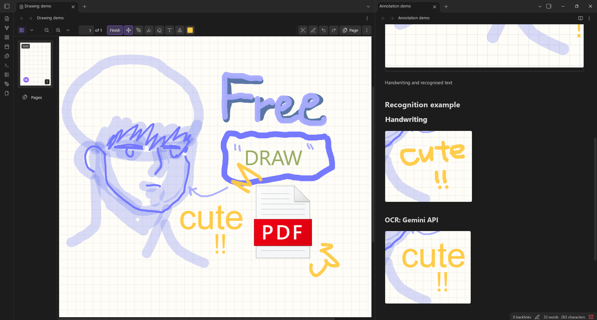

# Freedraw PDF

Write, draw and organise annotations on PDFs inside Obsidian. Add handwriting, highlights, text, shapes and images, insert writing pages, and export an annotated copy. Your original PDF stays unchanged while you work.

Requires **Obsidian 1.12.0 or later**.



## Features

- **Pen and highlighter:** separate presets, colours and widths, pressure-aware strokes, freehand and straight-line modes, and solid, dashed, dotted or wavy lines.
- **Shapes:** drag to size a shape or draw and hold to fit a line, rectangle, ellipse or triangle. Use modifiers for regular shapes.
- **Selection and erasing:** move, resize, duplicate and copy annotations. Erase whole objects or sections of ink.
- **Text and images:** add formatted text boxes and embedded images to your document.
- **Writing pages:** insert blank, ruled, grid or dotted pages with your choice of paper size and colour.
- **Handwriting recognition:** review a transcript, then switch between original handwriting and selectable, read-only text.
- **Note embeds:** display an annotated page or selected region inside a Markdown note.
- **Export:** create a separate annotated PDF, including added pages and selectable typed or accepted OCR text.

## What’s new in 0.13.8

- Optional OCR with Gemini, an OpenAI-compatible service or a separately installed local helper.
- Drag-to-size and draw-and-hold Shapes controls.
- Improved partial erasing, template thumbnails and page navigation.

See the [release notes](docs/releases/0.13.8.md) for details.

## Install

1. Download `main.js`, `manifest.json` and `styles.css` from [GitHub Releases](https://github.com/vividasasana/freedraw-pdf/releases).
2. Create `.obsidian/plugins/freedraw-pdf` inside your vault.
3. Place those three files directly in that folder.
4. Reload Obsidian and enable **Freedraw PDF** under **Settings → Community plugins**.

## Start annotating

Open a PDF and select **Annotate** in its toolbar, or use the command palette. Choose a tool and write, draw or place an annotation. Select **Finish** to return to reading.

Choose **Menus** or **Text buttons** for contextual tool options in settings. Menus open from the active tool icon; text buttons provide quick access to the relevant options.

For Shapes, choose **Drag to size** or **Draw and hold**. In draw-and-hold mode, draw a shape and pause briefly without lifting. Shapes are freely sized unless you hold a configured regular-shape modifier.

Open **Page** to add writing space or manage pages. Configure the initial template and paper colour in settings; later added pages follow the most recently created or restyled page in the same document.

For finger scrolling while writing with a stylus, choose **Pan with finger**. Input behaviour and palm rejection depend on your device.

## Recognise handwriting

Configure a recognition provider in the plugin settings, then open **Handwriting recognition** from the PDF toolbar. Recognise selected handwriting, the current page or handwriting across the PDF. Review the returned text before accepting it.

Accepted text is read-only and selectable. Switch between handwriting and text for the current page; the original strokes stay saved. You can also paste a transcript recognised elsewhere without contacting a service through the plugin.

Online providers require your own API credentials and may have usage charges. A local recognition helper requires separate installation. See [handwriting recognition](docs/handwriting-recognition.md).

## Include annotations in your notes

Use the embed command to copy an annotated page or selected region into a note. The embed reads the saved annotation data.

You can also write a block yourself:

````markdown
```freedraw-pdf
path: Documents/example.pdf
page: 1
width: 720
```
````

Set `path` to the PDF’s vault-relative location and `page` to the page you want to display.

## Saving and exporting

Editable annotations are saved in a companion **`.annot.json` file beside the PDF**. Keep both files when backing up, syncing or transferring your work. Imported annotation images are stored in the annotation data.

Export creates a separate PDF for sharing. Keep the original PDF and its annotation file to continue editing in Freedraw PDF.

## Privacy

Drawing and local annotation storage require no account. The plugin does not use analytics.

When you request online handwriting recognition, the chosen handwriting image is sent to your configured provider. Refreshing available models also contacts that provider. API credentials are stored using Obsidian’s secret storage. Your provider’s terms and privacy policy apply to its processing.

A local helper or manually pasted transcript provides an alternative to online recognition. PDFs and annotation data remain in your vault, subject to your backup and sync settings. See [Privacy](docs/privacy.md) for details.

## Known limitations and feedback

Dense annotation pages can still render slowly.

Report problems through [GitHub Issues](https://github.com/vividasasana/freedraw-pdf/issues). Include your Obsidian/plugin versions, operating system, input device and reproduction steps. Share sample files or recordings if possible, after removing private information.

For security reports, follow the [security policy](SECURITY.md).

## Contributing and license

See [Contributing](CONTRIBUTING.md) for local development and checks.

Freedraw PDF is licensed under [MIT](LICENSE). See [third-party notices](THIRD-PARTY-NOTICES.md) for bundled dependencies.
